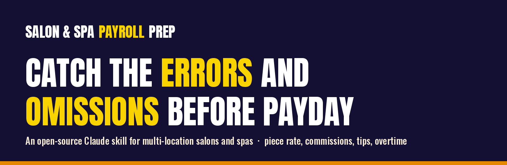
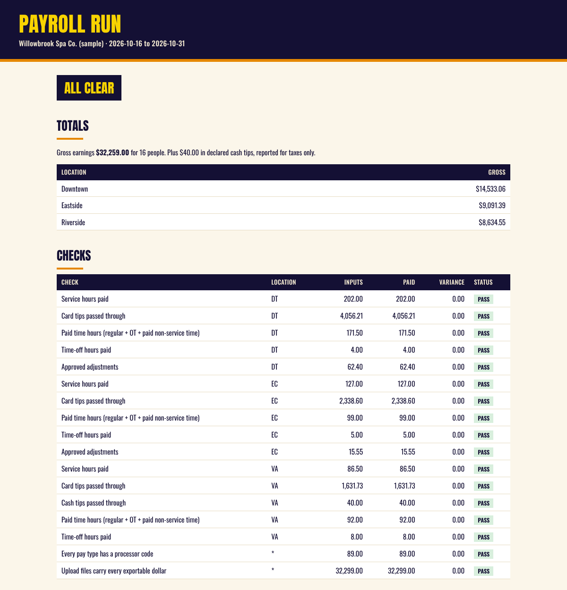
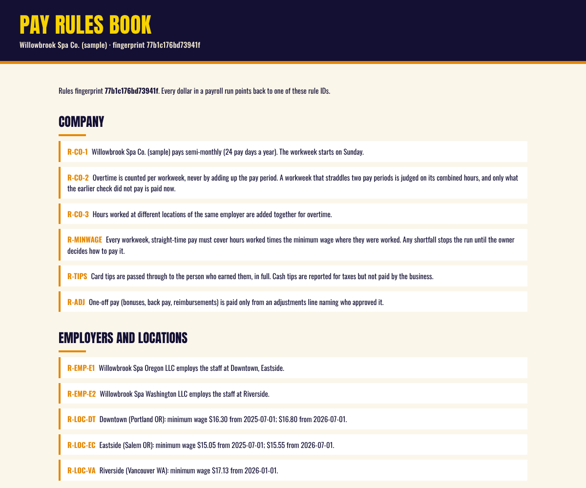

# Salon & Spa Payroll Prep

An open-source Claude skill that prepares and checks payroll for salons, spas, massage
and wellness businesses, from one location to many. You give it your pay rules once and
your booking/POS and HR exports each pay period. It hands back a review workbook, a
plain-English run summary, and upload files for your payroll system, and it refuses to
call a payroll clean until every input is accounted for and an independent recount agrees.

It never submits payroll. You review, you approve, you upload.

## Why this exists

Spa payroll is not hard math. It is a lot of small rules spread across many reports:
piece rate per service hour, minimum wage for lobby time, a different spiff for every
add-on, tiered membership commission paid monthly, gift card commission only during the
holidays, tips, sick time, overtime that crosses pay periods and locations. Almost every
mistake that reaches a paycheck is an omission: a missing export, a column read one
position off, a person filtered out of a report, a new add-on code nobody priced.

Alison built the original system with Claude, with Laszlo's help, to run the real
payroll for a five-location massage and skin care business. A 3-4 person job spread over
three days became one person and about half an hour from "go" to audited workbooks.
Every check in it exists because something like it went wrong once.
See [the lessons](skills/salon-spa-payroll/references/lessons.md).

## What it does

- **Intake.** An 87-question interview (or a fillable, branded intake workbook) turns how
  you actually pay people into a settings file and a **Pay Rules Book** you read and sign.
  Every dollar in a run points back to a rule ID in that book.
- **Pay.** Piece rate per service hour, per service or percent of revenue; hourly and
  salary; lobby, training, trainer and meeting time; add-on spiffs at your rate, never the
  customer price; retail, membership (tiered), gift card and package commissions with
  date windows; manager overrides, stipends and scorecard bonus pools; tips; sick time and
  PTO; one-off adjustments with an approver.
- **Overtime done right.** Per workweek, never per pay period. Hours at locations of the
  same employer are added together. A week that straddles two pay periods is judged on
  its combined hours. Commissions raise the overtime rate, and monthly commissions get a
  true-up for the weeks they were earned in. Daily overtime and double time where a
  state requires it.
- **Gates before any math.** Missing sick-time export, report dates that do not match the
  period, mapped rows that do not add up to the report's own totals, activity after a
  termination date, service hours of zero, implausible hours per service, people with no
  activity at all.
- **Checks after.** Service hours, tips, paid hours, time off and adjustments reconcile
  to the inputs by location; the upload files carry every exportable dollar.
- **An independent audit.** A second, separate computation recomputes every employee's
  pay from the inputs and must agree with the engine.
- **Warnings need a decision.** A run is ALL CLEAR only when the rules are signed, every
  check passes, the audit agrees, and every warning is either fixed or acknowledged in
  writing by a named person.
- **Upload files** for BambooHR (hours + extra pay), ADP Workforce Now (paydata batch),
  Paylocity (earnings import), HiBob (one-time payments) or a generic CSV, and roster,
  rate and time-off imports from the same systems. Each one is an editable profile.



## Try it

In Claude Code:

```
/plugin marketplace add szalvay/salon-spa-payroll
/plugin install salon-spa-payroll@salon-spa-payroll
```

Then ask Claude something like "show me the sample spa payroll" or "help me set up my
salon's pay rules".

Or run the engine yourself (Python 3.10+):

```bash
pip install openpyxl
P=skills/salon-spa-payroll/scripts/payroll.py
python3 $P sample ./demo
python3 $P approve ./demo --by "Your Name"
for p in 2026-10-01_2026-10-15 2026-10-16_2026-10-31; do
  python3 $P hris-import demo/periods/$p --roster demo/periods/$p/raw/bamboohr_roster_export.csv \
    --time-off demo/periods/$p/raw/bamboohr_time_off_used.csv
  python3 $P run demo/periods/$p
done
```

The sample is a made-up three-location spa in two states with sixteen people and every
hard case we could think of. The [walkthrough](skills/salon-spa-payroll/references/getting-started.md)
shows what to look at and how to break it on purpose.

## How a pay period runs

```
your POS / booking reports ─┐
your HR roster + time off ──┼─> canonical CSVs ─> gates ─> pay engine ─> checks ─> independent audit
your signed pay rules ──────┘                                                      │
                                     review workbook + run summary + upload files <┘
                                     ALL CLEAR / NOT CLEAR / BLOCKED, with evidence.json
```

Claude maps each export into a handful of plain CSV files and records each report's own
totals. The engine reads nothing else, so it works with any POS: Meevo, Mindbody,
Boulevard, Vagaro, Zenoti, Square Appointments, Phorest or a spreadsheet.



## Limits

- **Not legal, tax or payroll advice.** State rules ship as presets for Oregon,
  Washington, California and a federal baseline, and every one must be confirmed by the
  owner with their payroll provider or counsel. The engine does not track law changes.
- **It does not compute taxes, deductions or net pay.** It prepares gross earnings for
  the payroll system that does.
- **No sensitive identifiers.** It needs names, IDs, rates and hours. It never asks for
  Social Security numbers, bank details or dates of birth.
- **Connector profiles are templates.** Compare each one with the import template from
  your own account before the first live upload.

## Repository layout

```
.claude-plugin/              plugin and marketplace manifests
skills/salon-spa-payroll/
  SKILL.md                   what Claude follows
  references/                questionnaire, config and input formats, POS mapping, connectors, state rules, lessons, auditor brief
  scripts/payroll.py         the command line
  scripts/spapay/            the engine (gates, calc, checks, audit, intake, rulebook, connectors, outputs)
  assets/                    connector profiles, state presets, intake questions, starter config, sample workspace
tests/                       engine tests (python3 -m unittest discover -s tests)
tools/                       regenerate the sample, the reference docs and the images
```

## Contributing

Issues and pull requests are welcome, especially connector profiles for more payroll
systems, state presets confirmed against official sources, and real-world failure modes.
Every new check comes with a test that reproduces the mistake. See
[CONTRIBUTING.md](CONTRIBUTING.md).

## License

Apache License 2.0. Copyright 2026 Laszlo Szalvay. See [LICENSE](LICENSE) and [NOTICE](NOTICE).
