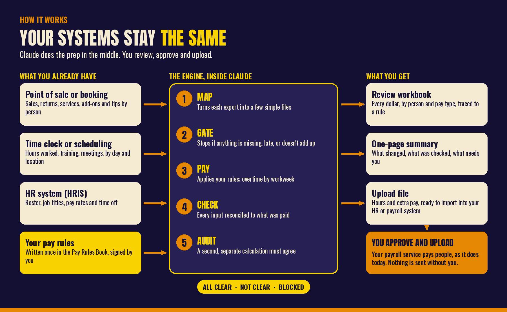
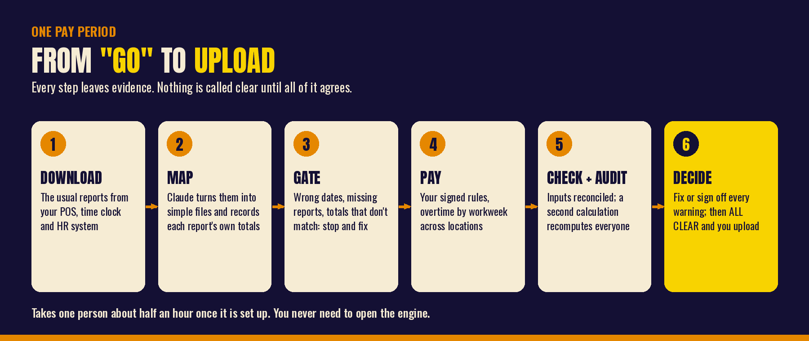

# Payroll Prep for Small Businesses

**Free, open-source help for getting payroll right before it goes out the door.** It works
inside Claude, for businesses with one location or many, and you don't need any payroll
experience to use it.

You tell it once, in plain words, how you pay people. Every pay period you hand it the
reports you already download from your point-of-sale system, time clock and HR system.
It works out what everyone should be paid and checks the result from several directions.
Then it gives you three things: a workbook to review, a one-page summary, and a file you
upload to your payroll system.

It never pays anyone and never touches a bank account. You review it, you approve it,
and you upload it.

> **Not legal, tax or payroll advice.** Use it to prepare and double-check payroll, then
> confirm your state's rules with your payroll provider or an employment lawyer.

## Is this for me?

Probably, if most of these are true:

- You run a small business, or you help run one: a store, a salon, a studio, a clinic, a
  shop, a field-service crew.
- People are paid **by the hour**, **by salary**, **by commission or bonus**, **with
  tips**, or **by the service, job, class or unit** (piece rate). Any mix is fine.
- You use a payroll service such as ADP, Paylocity, BambooHR, HiBob, Gusto or similar, and
  someone has to get hours and extra pay into it every pay period.
- That person spends hours copying numbers between reports and spreadsheets, and still
  worries about missing something.

It is **not** the right tool if you need it to run payroll itself (calculate taxes,
withholding, direct deposit). Your payroll service does that. This tool prepares what you
give it.

## What "payroll prep" means, in plain English

Between "the pay period ended" and "everyone got paid" there is a messy middle:

1. **Gather** hours from the time clock, sales and tips from the register, time off from
   the HR system.
2. **Apply your rules:** who gets commission on what, what training hours pay, when
   overtime kicks in, who gets this month's bonus.
3. **Check** that nobody was missed and nothing was counted twice.
4. **Upload** hours and extra pay to the payroll service.

Most payroll mistakes are not bad math. They are things left out: a report that never got
downloaded, a column read one spot over, a person filtered out of an export, a new
product nobody set a commission rate for, overtime that was missed because someone
worked at two locations. This tool is built to catch exactly those.

## How it fits with what you already use



## The idea: Claude in the middle

Most software promises to replace something: a new payroll system, a new register, a new
HR platform. This doesn't. Your systems stay exactly as they are. The point of sale keeps
the sales, the time clock keeps the hours, the HR system keeps the people, and the
payroll service keeps paying them.

What breaks in a small business is rarely inside those systems. It breaks in the middle,
between them: the exports, the spreadsheets, the copying and pasting, the "did anyone
pull the time-off report?" That middle is where the hours go and where the mistakes hide.

We think of Claude as a **middle-to-middle** system. It doesn't start the work and it
doesn't finish it. A person starts it (the pay period ends and someone says go) and a
person finishes it (someone reviews, approves and uploads). Claude takes the middle:
reading the exports, applying your rules, checking everything twice, and explaining what
it found in plain English.

A few principles follow from that:

- **People own both ends.** You set the rules and you decide what gets paid. Claude never
  submits anything.
- **Rules are written down, not remembered.** The Pay Rules Book is the agreement between
  you and the machine. If a rule isn't in the book, Claude asks instead of guessing.
- **The math is code, not conversation.** Claude talks with you; a tested engine does the
  arithmetic, and a second, independent calculation checks it. A chatbot should never be
  the thing adding up a paycheck.
- **Evidence beats confidence.** "Looks right" doesn't count. A pay period is clear only
  when every report total, every check and the audit agree, and the proof is saved.
- **The ends stay swappable.** Claude only works with exports, so you can change your
  register or your payroll provider and keep your rules.

The same pattern fits far more than payroll: month-end close, commissions, inventory,
scheduling. Anywhere a small business has good systems at both ends and a person doing
glue work in the middle.

## What it does for you

- **Asks how you pay people, in your industry's language.** A short interview (or a
  fill-in-the-blanks workbook) with questions tailored to your industry. It writes your
  answers into a **Pay Rules Book** in plain English that you read and sign. Every dollar
  it calculates later points back to a rule in that book.
- **Works from the reports you already have.** No new software to learn. Claude reads
  your exports, whatever system they come from, and turns them into a few simple files.
- **Checks before it calculates.** Missing time-off report? Report for the wrong dates?
  A report whose own total doesn't match what was copied out of it? Someone with sales
  after their last day? It stops and tells you exactly what to fix.
- **Gets overtime right.** Overtime is judged per workweek, not per pay period. It adds up
  hours across all locations of the same company, carries hours across pay periods, and
  applies daily overtime where a state requires it (like California). It also counts
  commission and bonuses when figuring the overtime rate, which is the part most people
  miss.
- **Pays what you promised.** Hourly, salary, commission with returns taken back out,
  spiffs, tiered bonuses, tips, sick time and PTO, pay per service or job, stipends,
  manager bonuses, one-off adjustments.
- **Double-checks itself.** A second, separate calculation recomputes everyone's pay and
  must agree with the first.
- **Won't say "all clear" until it is.** A pay period is ALL CLEAR only when your rules are
  signed, every check passes, the second calculation agrees, and every warning has
  been fixed or signed off by a named person. Otherwise the upload file is literally named
  `DO_NOT_UPLOAD_...`.
- **Hands you the upload file** for BambooHR, ADP Workforce Now, Paylocity, HiBob or a
  generic spreadsheet.


## Why this exists

Alison built the original version with Claude, with Laszlo's help, to run the real payroll
for a five-location business with hourly staff, piece-rate pay, commissions and tips. A
job that took three or four people three days became one person and about half an hour,
from "go" to a checked, audited payroll. Every check in it exists because something like
it once went wrong. [Read the lessons](skills/small-business-payroll-prep/references/lessons.md).

We are giving it away because every small business owner we know has a version of that
story.

## Industries

The intake asks different questions depending on your industry, and it tells you up
front about anything your industry needs that this tool doesn't do yet.

| Industry | For example | Good fit for |
|---|---|---|
| Technology & Software | software companies, IT services, agencies | Hourly support staff, salaries, sales commission, on-call pay |
| Entertainment | venues, event companies, family entertainment, recreation | Hourly event staff, tips and gratuities, day rates, ticket and party spiffs |
| Healthcare & Life Sciences | massage, spa and wellness, chiropractic, physical therapy, fitness studios | Pay per hour of service, per visit or a percent of revenue; add-ons; memberships; tips |
| Manufacturing & Industrial | small manufacturers, food production, print and machine shops, auto repair | Hourly crews, pay per unit or flagged hour, production and attendance bonuses |
| Financial Services | insurance agencies, mortgage offices, tax and accounting firms | Commission with chargebacks, seasonal overtime, production bonuses |
| Energy & Utilities | solar, electrical, HVAC, plumbing, field service and home service trades | Field crews, drive time between jobs, per-job pay, standby pay, daily overtime |
| Retail | stores, salons, cafes and counter-service food, automotive service | Hourly staff with commission and spiffs, returns, tips, store manager bonuses |
| Education | private schools, tutoring centers, childcare, music and driving schools | Pay per session or lesson, hourly aides, extra-duty stipends |
| Government & Defense | small government contractors | Ordinary hourly and salaried payroll only (see the limits below) |

The full list of questions, and the honest list of what each industry needs that isn't
built yet, is in [the questionnaire](skills/small-business-payroll-prep/references/questionnaire.md).

## How to get it (no coding needed)

You need a paid Claude plan (Pro, Max, Team or Enterprise). Claude installs anything else
it needs by itself.

**Option 1: add it to the Claude app.** This works on the web and in the desktop app.

1. On this page, click the green **Code** button near the top, then **Download ZIP**.
2. Open the downloaded file. Inside, go to the `skills` folder. You'll see a folder
   named `small-business-payroll-prep`.
3. Make a ZIP of just that one folder. On Windows: right-click it, then **Send to**, then
   **Compressed (zipped) folder**. On a Mac: right-click it, then **Compress**.
4. In Claude, make sure **Code execution and file creation** is turned on in Settings.
   Then go to **Customize**, then **Skills**, click **+**, choose **Create skill**, then
   **Upload a skill**, and pick the ZIP you just made.
5. Start a new chat and say: *"Use the payroll prep skill to build the sample store
   payroll and walk me through it."*

**Option 2: Claude Code.** If you use Claude Code, type these two lines:

```
/plugin marketplace add szalvay/small-business-payroll-prep
/plugin install small-business-payroll-prep@small-business-payroll-prep
```

**Option 3: the Claude plugin directory.** We have submitted it to the directory. Until
it is listed there, use option 1 or 2.

## Try it in five minutes

Two made-up businesses come built in, so you can see the whole thing work before you
touch your own data:

- **A three-store outdoor retailer** with hourly staff, sales commission, returns, a
  coffee bar with tips, store managers on salary, and a California store with daily
  overtime. Ask Claude: *"Build the sample store payroll and show me what you checked."*
- **A three-location spa** with pay per hour of service, add-ons, memberships and tips.
  Ask Claude: *"Build the sample spa payroll and walk me through it."*

Then try breaking it on purpose ("delete the time-off file and run it again") and watch it
refuse.

When you're ready for your own business, say: *"Help me set up my pay rules."* Claude
starts with two questions: what industry you're in, and how people get paid.

## What it will not do

- **Run payroll.** No taxes, withholding, deductions, net pay or direct deposit. It
  prepares gross pay for the payroll service that does those.
- **Give legal advice or keep up with the law.** Overtime and minimum-wage rules come
  preloaded for federal law, Oregon, Washington and California. You confirm them, and
  any other state's, with your payroll provider or counsel.
- **A few things some industries need,** for now: tip credits (paying tipped staff below
  full minimum wage), tip-pool math, shift differentials, prevailing wage and certified
  payroll for government contracts, union pay scales, and draws against commission.
  Where a workaround exists (usually a one-off adjustment), the intake tells you.
- **Ask for sensitive personal data.** It needs names, employee IDs, pay rates and hours.
  It never asks for Social Security numbers, bank details or dates of birth.
- **Upload anything for you.** You stay in control of what goes to your payroll service.

## Payroll words, explained

| Word | What it means |
|---|---|
| Pay period | The stretch of days one paycheck covers: weekly, every two weeks, twice a month or monthly. |
| Workweek | A fixed seven-day week (for example Sunday to Saturday) that overtime is judged on. It doesn't have to line up with the pay period. |
| Overtime | Extra pay (usually 1.5 times) for hours over 40 in a workweek. Some states also have daily overtime, like after 8 hours in a day. |
| Regular rate | The hourly rate overtime is based on. It includes commissions and promised bonuses, not just the base wage. |
| Exempt | Salaried roles that the law says don't get overtime. Being on salary alone doesn't make someone exempt. |
| Piece rate | Pay per unit of work: per service, job, class, unit made or flagged hour, instead of per hour on the clock. |
| Commission | Pay based on what someone sold, usually a percent. |
| Spiff | A flat bonus for selling a specific thing, like $5 per protection plan. |
| Minimum wage | The lowest hourly pay allowed where the work happens. Cities and counties can set their own. Piece-rate and commissioned staff still have to clear it every week. |
| HRIS | Your HR system: where the roster, job titles, pay rates and time off live (BambooHR, ADP, Paylocity, HiBob and others). |
| POS | Point of sale: the register or booking system where sales, services and tips are recorded. |

## GitHub words, explained

| Word | What it means |
|---|---|
| Repository | This page and everything in it: the files that make up the tool. |
| Download ZIP | The green **Code** button's way of giving you all the files at once. You don't need an account. |
| Skill / plugin | A package of instructions and tools Claude can use. This repository is both: a plugin that contains one skill. |
| Issue | A question, problem report or request. Click **Issues** at the top to open one. You need a free GitHub account. |
| Pull request | A proposed change to the files, usually from a developer. You never need one to use the tool. |

## Questions, problems and ideas

Open an [issue](https://github.com/szalvay/small-business-payroll-prep/issues): describe
what you expected and what happened. Never paste real employee names, pay rates or
anything else private into an issue. Describe the situation with made-up numbers instead.

---

## For the technically curious

### How a pay period runs



Claude maps each export into a handful of plain CSV files and records each report's own
totals. The engine reads nothing else, so it works with any point-of-sale, booking, job
or time-clock system, or a spreadsheet.


### Run the engine yourself

Python 3.10 or newer:

```bash
pip install openpyxl
P=skills/small-business-payroll-prep/scripts/payroll.py
python3 $P sample ./store --kind retail      # or: python3 $P sample ./demo  (the spa)
python3 $P approve ./store --by "Your Name"
for p in 2026-10-05_2026-10-18 2026-10-19_2026-11-01; do
  python3 $P hris-import store/periods/$p --roster store/periods/$p/raw/adp_worker_export.csv \
    --time-off store/periods/$p/raw/adp_time_off.csv
  python3 $P run store/periods/$p
done
python3 $P intake-workbook intake.xlsx --industry retail
```

The [walkthrough](skills/small-business-payroll-prep/references/getting-started.md)
covers both samples, what to look at, and how to break them on purpose.

### Repository layout

```
.claude-plugin/              plugin and marketplace manifests
skills/small-business-payroll-prep/
  SKILL.md                   what Claude follows
  references/                questionnaire, config and input formats, POS mapping, connectors, state rules, lessons, auditor brief
  scripts/payroll.py         the command line
  scripts/payprep/           the engine (gates, calc, checks, audit, intake, rulebook, connectors, samples, outputs)
  assets/                    connector profiles, state presets, intake questions by industry, starter config
tests/                       engine tests (python3 -m unittest discover -s tests)
tools/                       regenerate the generated reference docs
```

### Contributing

Issues and pull requests are welcome, especially industry question packs, connector
profiles for more payroll systems, state presets confirmed against official sources,
and real-world failure modes. Every new check comes with a test that reproduces the
mistake. See [CONTRIBUTING.md](CONTRIBUTING.md).

## Who made this

Alison built it with Claude; Laszlo Szalvay helped and maintains it.

- **The E&O Show.** How founders, CEOs and ultrarunners really built it: the errors and
  the omissions, not just the wins. Hosted by Laz Szalvay and Brandon Hozack, premiering
  January 12, 2027, with new episodes every Tuesday. This tool is the show's idea put to
  work: most of what goes wrong in a business is something left out. Subscribe, watch
  the Shorts and find every link at [linktr.ee/eandoshow](https://linktr.ee/eandoshow).
- **Want help rolling Claude out at your small business?** See
  [Praecipio's Claude enablement for small business](https://www.praecipio.com/claude-enablement-small-business?utm_source=github&utm_medium=social&utm_campaign=eo_show).

## License

Apache License 2.0. Copyright 2026 Laszlo Szalvay. See [LICENSE](LICENSE) and [NOTICE](NOTICE).
